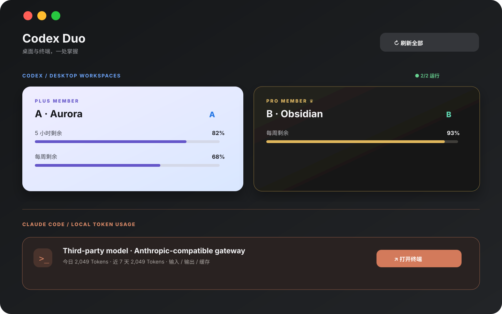

# Codex Duo

一个面向个人开发者的 macOS 控制台：把多个 Codex 桌面工作区、Claude Code CLI、额度监控和任务交接放到一处管理。



> 这是一个本地集成工具。仓库不包含登录会话、API Key、额度缓存或任何服务商凭据。

## 我们做了什么优化

同类账号切换工具通常只负责保存配置或轮换登录状态，Codex Duo 把工作区管理和任务连续性放在一起：

- **两个独立 Codex 工作区**：每个账号使用独立 `CODEX_HOME` 和桌面数据目录，避免退出重登和账号串线。
- **固定身份 + 订阅视觉**：A/B 身份标记始终不变；Pro、Plus、Free 使用不同卡片视觉，两个 Pro 也不会混淆。
- **真实额度读取**：通过各自本机 Codex `app-server` 读取额度。Pro 只显示每周额度，Plus 等账号按接口显示可用窗口。
- **统一工作台**：Codex 桌面工作区和 Claude Code 终端工作区在同一页用分区和细分割线区分，最近任务和用量趋势同时展示两边内容。
- **Claude Code 本机 Token 统计**：统计输入、输出、缓存 Token、请求数和近 7 天曲线；按响应 ID 去重，不上传对话正文。
- **按最新完成时间同步**：同步会话与项目时比较真实回合完成时间，保留原会话 ID，运行中的任务会等待完成并自动继续同步。
- **跨客户端交接**：Codex ↔ Codex 和 Codex ↔ Claude Code 都可以生成本地交接包，沿用原项目目录。
- **凭据留在本机**：Claude Code 服务商密钥写入 macOS 钥匙串；Codex 登录状态保留在本机账号目录。

## 界面预览

首页分成两块：上方是 Codex 账号卡片，下方是 Claude Code 的模型和本机 Token 消耗。暖铜色只用于 CC 区域，蓝紫和黑金用于 Codex 会员卡。

## 快速开始

需要 macOS 14+、Xcode Command Line Tools 和 Python 3。

```sh
git clone <你的仓库地址>
cd codex切换监控用量平台
./build.sh
open "dist/Codex Duo.app"
```

首次打开第二个 Codex 工作区后，在该窗口完成网页登录。之后在 Duo 主窗口点击刷新，额度和最近任务会自动出现。

## Claude Code CLI

在「设置 → Claude Code 服务商」填写兼容 Anthropic Messages API 的网关地址、模型 ID 和密钥。密钥只进入 macOS 钥匙串，不会写入仓库。首页 CC 区域的「打开终端」会创建一个使用当前配置的新 CLI 会话。

本机统计包括 `~/.claude/projects/` 下可读取的会话，以及子任务记录。统计的是本地 Token 使用量，不是服务商账单。服务商余额和套餐剩余额度需要服务商提供独立的查询接口，目前界面不会伪造实时余额。

## 同步和交接

- **同步会话与项目**：以同一会话最后完成的回合为比较依据，较新版本覆盖较旧版本，覆盖前自动备份。
- **运行中保护**：任一窗口正在执行任务时，Duo 不重启该窗口；任务结束后处理排队的同步请求。
- **任务交接**：目标客户端创建新会话，读取交接包和当前项目目录。源任务继续保留，后续新消息需要重新生成交接包。

## 构建与测试

```sh
./build.sh
python3 -m unittest discover -s tests
```

构建输出位于 `dist/Codex Duo.app`，已被 `.gitignore` 排除。应用运行时产生的账号数据、用量缓存、交接包和备份也不会进入 Git。

## 发布范围

仓库公开的是本地客户端代码和界面示例。不会发布：

- 你的 Codex 登录状态或账号数据；
- Claude Code / 第三方服务商 API Key；
- 额度缓存、任务交接包和项目文件；
- 可直接替你承担模型费用的代理服务。

详见 [SECURITY.md](SECURITY.md) 和 [LICENSE](LICENSE)。个人本地使用免费；托管、商业部署、代运营或模型路由服务需要单独许可。

## 参考

- [edihasaj/codex-account-switcher](https://github.com/edihasaj/codex-account-switcher)
- [4LAU/codex-profile-switcher](https://github.com/4LAU/codex-profile-switcher)

本项目代码独立编写，参考项目仅用于了解账号隔离和配置管理思路。
